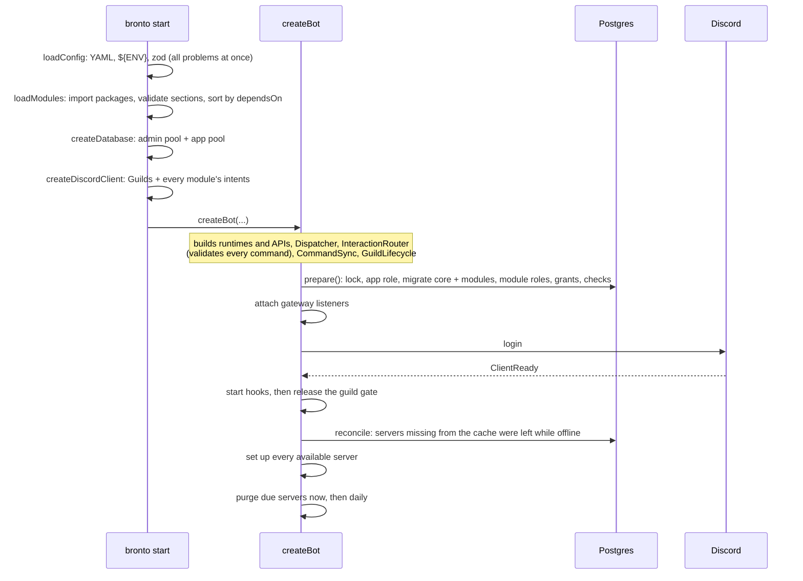
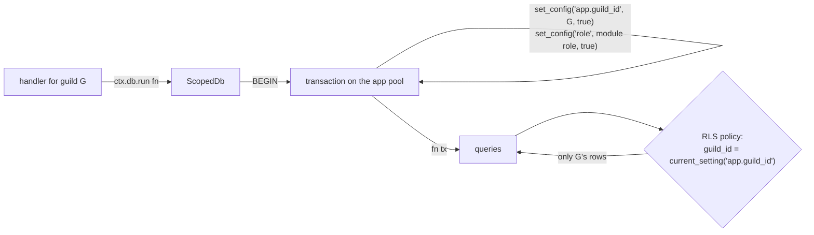
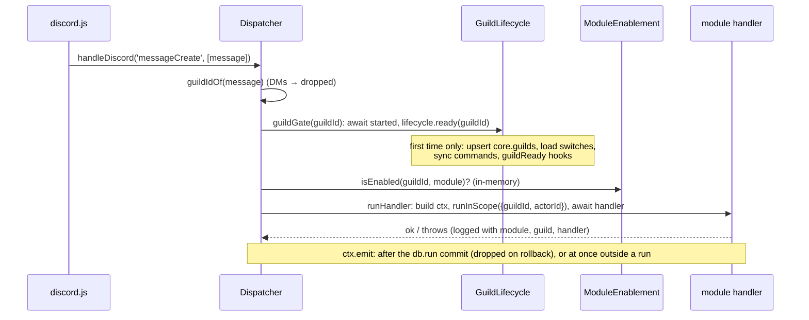
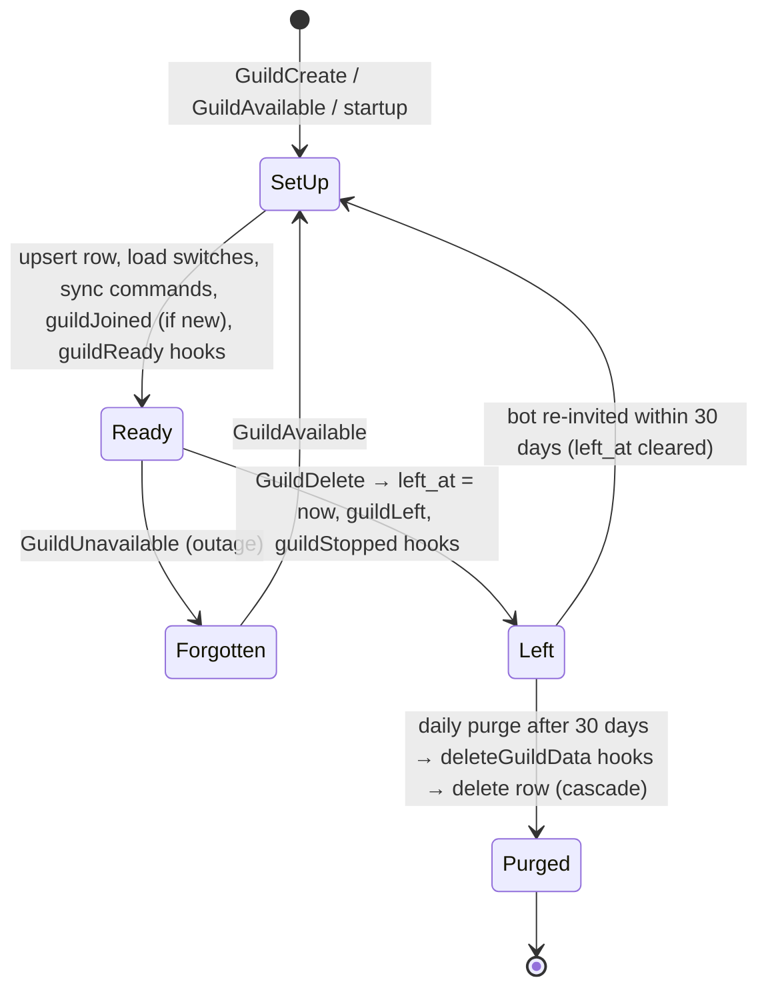

# bronto developer guide

This guide has two parts:

- **Part 1, building modules:** a tutorial that builds a complete module step by step and covers the public API.
- **Part 2, how bronto works:** the internal structure, the startup sequence, and what happens between a Discord event
  and your handler.

Read Part 1 to write modules. Read Part 2 to change the core, or to understand why the rules in Part 1 exist.

Contents:

- [Part 1: Building modules](#part-1-building-modules)
  - [1. The mental model](#1-the-mental-model)
  - [2. A module package](#2-a-module-package)
  - [3. Settings](#3-settings)
  - [4. Storing data](#4-storing-data)
  - [5. Slash commands](#5-slash-commands)
  - [6. Buttons, selects and modals](#6-buttons-selects-and-modals)
  - [7. Listening to Discord events](#7-listening-to-discord-events)
  - [8. Events and asks between modules](#8-events-and-asks-between-modules)
  - [9. Lifecycle hooks](#9-lifecycle-hooks)
  - [10. Background work: queues and timers](#10-background-work-queues-and-timers)
  - [11. CRUD commands](#11-crud-commands)
  - [12. Importing data from an older bot](#12-importing-data-from-an-older-bot)
  - [13. Testing a module](#13-testing-a-module)
  - [14. Rules of thumb](#14-rules-of-thumb)
- [Part 2: How bronto works](#part-2-how-bronto-works)
  - [15. Repository map](#15-repository-map)
  - [16. Startup](#16-startup)
  - [17. The database layer](#17-the-database-layer)
  - [18. The hot path: a gateway event](#18-the-hot-path-a-gateway-event)
  - [19. The interaction path](#19-the-interaction-path)
  - [20. KeyedQueue](#20-keyedqueue)
  - [21. Guild lifecycle](#21-guild-lifecycle)
  - [22. Command sync](#22-command-sync)
  - [23. The CLI and deployment](#23-the-cli-and-deployment)
  - [24. Case study: the sticky module](#24-case-study-the-sticky-module)
  - [25. Where to look](#25-where-to-look)

---

# Part 1: Building modules

## 1. The mental model

A bronto bot is a small **core** plus a set of **modules**. A deployment lists the modules it loads in `config.yaml`.
The core owns everything a module shouldn't have to think about:

- **The Discord connection.** The core asks for the intents the loaded modules need, receives gateway events and
  routes them to the modules.
- **Guilds.** It tracks which servers the bot is in, keeps a server's data for 30 days after the bot leaves, then
  deletes it.
- **Per-server switches.** `/modules enable|disable` turns a module on or off in one server. A module that is off gets
  no events, its commands disappear from that server, and its data is kept.
- **The database.** Every module gets its own Postgres schema and its own migrations. Row-level security keeps each
  server's rows apart, so a handler running for server A can't read or write server B's rows, even by mistake.
- **Slash commands.** The core registers each server's commands, routes interactions to the module that owns them,
  defers slow answers and turns errors into user-facing messages.

A module is a **declaration**. It doesn't call `client.on(...)` or register commands itself. It describes what it
listens to and what it offers, and the core calls it:

```ts
export default defineModule({
  name: 'karma',                 // also its Postgres schema and the prefix of its events and logs
  intents: [...],                // gateway intents it needs
  config: zodSchema,             // validates its section of config.yaml
  db: { schema, migrations },    // its tables and migration folder
  commands: { name: ... },       // slash commands, keyed by name
  components: [...],             // buttons and modals
  listeners: [on(...)],          // Discord events and other modules' events
  events: {...},                 // events it emits
  asks: {...},                   // asks it poses to other modules (gates, collectors)
  api: (ctx) => ({...}),         // functions other modules may call
  dependsOn: [...],              // modules that must be loaded and on
  optionalDependsOn: [...],      // modules it uses when present
  hooks: { start, guildReady, guildStopped, deleteGuildData },
  importLegacy: (ctx, path) => ..., // optional: data import from an older bot
});
```

Every piece of module code runs as a **handler**: one run, for one server, with a context object (`ctx`). The context
carries the server (`ctx.guildId`), the user who caused the work (`ctx.actorId`), a database handle limited to that
server (`ctx.db`), a logger, the module's settings and the discord.js client.

## 2. A module package

The tutorial builds a `karma` module: members thank each other with `/karma give @user`, and the bot counts the points.
The karma code in this tutorial comes from a module that typechecks against the current core and passes the tests in
section 13.

A module is a workspace package. In this repository, modules live in `modules/` (and examples in `examples/`):

```
modules/karma/
├── package.json
├── tsconfig.json
├── drizzle.config.ts
├── drizzle/              generated migrations (committed)
├── src/
│   ├── index.ts          default export: the module definition
│   └── db/schema.ts      tables
└── test/
    └── karma.test.ts
```

`package.json`. bronto runs TypeScript sources directly through `tsx`, so there is no build step, and `exports`
points at the `.ts` file. Pin exact versions, the same ones the core uses:

```json
{
  "name": "@bronto/karma",
  "version": "0.0.0",
  "private": true,
  "type": "module",
  "exports": { ".": "./src/index.ts" },
  "scripts": {
    "typecheck": "tsc --noEmit",
    "db:generate": "drizzle-kit generate"
  },
  "peerDependencies": {
    "@bronto/core": "workspace:*",
    "discord.js": "14.27.0",
    "drizzle-orm": "0.45.4",
    "zod": "4.6.7"
  },
  "devDependencies": {
    "@bronto/core": "workspace:*",
    "discord.js": "14.27.0",
    "drizzle-kit": "0.31.11",
    "drizzle-orm": "0.45.4",
    "zod": "4.6.7"
  }
}
```

The framework libraries are peer dependencies: a peer means "use the host's copy", so discord.js and drizzle-orm exist
once in the running bot and `instanceof` and drizzle's `is()` checks work across the module boundary. pnpm warns when
the host's version does not match the declared one. The `devDependencies` copies are only for the module's own
typecheck and tests: a production install (`pnpm install --prod`) skips them, so the workspace root must list every
peer in its `dependencies`, at the same versions.

`tsconfig.json`:

```json
{
  "extends": "../../tsconfig.base.json",
  "include": ["src", "test", "drizzle.config.ts"]
}
```

The smallest working module:

```ts
// src/index.ts
import { defineModule } from '@bronto/core';

export default defineModule({ name: 'karma' });
```

Module names become Postgres schema names. A name must match `^[a-z][a-z0-9_]{0,62}$`: a lowercase letter first, then
lowercase letters, digits and `_`, at most 63 characters. These names are reserved: `core`, `migrations`, `public`,
`information_schema` and anything starting with `pg_`.

To load the module:

1. Add it to the root `package.json` dependencies (`"@bronto/karma": "workspace:*"`), then run `pnpm install`. The
   loader resolves module packages from the directory the bot runs in, so the package must be a dependency there.
2. List it in `config.yaml`:

   ```yaml
   modules:
     "@bronto/karma": {}
   ```

The Docker image needs no change: it installs every dependency of the root `package.json`, and its build fails when
one of the listed modules can't resolve its imports.

Start the bot with `pnpm bronto start`. The log line "Bot started" lists the loaded modules, and `/modules list` shows
them in each server.

### User docs

A module can ship help pages that members read in Discord with `/help`. Put them in `docs/user/` (one Markdown file per
topic, `index.md` first) and point `defineModule` at the folder:

```ts
export default defineModule({
  name: 'karma',
  docs: new URL('../docs/user/', import.meta.url),
  // ...
});
```

Call `checkDocs(new URL('../docs/user/', import.meta.url), 'karma')` from `@bronto/core/testing` in a test so a broken
page fails the build. A module without `docs` does not appear in `/help`. The file format, its limits and everything
the check rejects are in [Writing user docs](writing-user-docs.md).

## 3. Settings

A module's section of `config.yaml` is validated by a zod schema. The validated value is `ctx.config`:

```ts
import { z } from 'zod';

const configSchema = z
  .object({
    /** Points a single /karma give adds. */
    step: z.number().int().min(1).max(10).default(1),
  })
  .strict();
type KarmaConfig = z.infer<typeof configSchema>;

export default defineModule<KarmaConfig>({
  name: 'karma',
  config: configSchema,
});
```

```yaml
modules:
  "@bronto/karma":
    step: 2
```

- `.strict()` turns typos into startup errors instead of silently ignored settings.
- An empty section (`"@bronto/karma":` or `{}`) parses as `{}`, so defaults apply.
- Any string in `config.yaml` may use `${ENV_VAR}`, `${ENV_VAR:-default}` and `$$` for a literal `$`. The core
  substitutes these after parsing the YAML, so a value from the environment can never change the file's structure.
- A module without `config` refuses non-empty settings.
- All problems from all modules are reported together, with paths like `modules.@bronto/karma.step`.

Settings apply to the whole deployment. They aren't per server; per-server settings belong in a table.

The core has one setting of its own besides `discord`, `database` and `modules`: `interactions.secret` signs the custom
IDs of buttons, selects and modals (section 6). It must be at least 32 characters and is required once a loaded module
defines components:

```yaml
interactions:
  secret: ${INTERACTION_SECRET}   # openssl rand -base64 32
```

## 4. Storing data

### Tables

Tables are Drizzle tables, declared with two helpers from `@bronto/core/tables`:

- **`guildTable(schema, name, columns, extra?)`** for per-server data, which is almost everything. It adds:
  - a `guild_id` column with a foreign key to `core.guilds` (`ON DELETE CASCADE`) and an index on it
  - a row-level security policy that only shows rows of the current server
  - the audit columns `created_at`, `updated_at`, `created_by` and `updated_by`
- **`globalTable(schema, name, columns, extra?)`** for data shared by all servers. It adds only the audit columns. Use
  it rarely. Only the owning module's role can write it, and a write affects every server; core's global tables are
  read-only for handlers.

The startup checks look at what Postgres holds in core's schema and in each loaded module's schema. They reject any
table that doesn't keep servers apart: it needs row-level security, a policy and a foreign key to `core.guilds` with
`on delete cascade`. Tables declared with `globalTable` are exempt. Views are always rejected.

```ts
// src/db/schema.ts
import { guildTable } from '@bronto/core/tables';
import { integer, pgSchema, primaryKey, text } from 'drizzle-orm/pg-core';

export const karmaSchema = pgSchema('karma'); // must equal the module name

export const points = guildTable(
  karmaSchema,
  'points',
  {
    userId: text('user_id').notNull(),
    points: integer('points').notNull().default(0),
  },
  // User IDs repeat across servers, so the key includes the guild.
  (t) => [primaryKey({ columns: [t.guildId, t.userId] })],
);
```

Things to know:

- **Global tables are shared by all servers.** A `globalTable` has no `guild_id` and no row-level security, so the
  startup checks skip it. Use it sparingly. Only the owning module's role can write it, and a write affects
  every server, so keep it for genuinely shared data. Core's global tables are read-only for handlers.
- **Prefer `@bronto/core/tables` in schema files.** drizzle-kit loads schema files, and the main entry point pulls in
  discord.js, pino and the runtime. Importing from `@bronto/core` works too.
- **Keys:** a Discord ID that is only unique within a server (a user, a member) needs `guildId` in its primary key or
  unique index. A globally unique ID, such as a channel or message, can be the key alone.
- **`guild_id` fills itself in:** inside a handler, an insert sets `guild_id` to the handler's server.
- **The audit columns fill themselves in:** `created_by` and `updated_by` get the acting user, or null when the bot
  acted on its own. Don't declare columns with these names; the helpers refuse it.

### Migrations

`drizzle.config.ts`:

```ts
import { defineModuleDrizzleConfig } from '@bronto/core/drizzle-config';

export default defineModuleDrizzleConfig({ name: 'karma' });
```

Generate a migration after every schema change and commit it:

```bash
pnpm --filter @bronto/karma db:generate
```

Generating doesn't need a database. Each module's migration history is kept in its own table, `migrations.karma`.

To hook the tables up, pass the schema module and the migrations folder:

```ts
import * as schema from './db/schema.js';

export default defineModule<KarmaConfig>({
  name: 'karma',
  config: configSchema,
  db: { schema, migrations: new URL('../drizzle/', import.meta.url) },
});
```

At every start the bot applies pending migrations, grants the module's role access to the new tables and checks that
every table keeps servers apart. If a check fails, the bot refuses to start and lists the problems.

### Reading and writing

`ctx.db` is a `ScopedDb` for the handler's server. Each `run` is one transaction:

```ts
import type { HandlerContext } from '@bronto/core';
import { sql } from 'drizzle-orm';

async function addPoints(ctx: HandlerContext<KarmaConfig>, userId: string): Promise<number> {
  const [row] = await ctx.db.run(async (tx) =>
    tx
      .insert(points)
      .values({ userId, points: ctx.config.step })
      .onConflictDoUpdate({
        target: [points.guildId, points.userId],
        set: { points: sql`${points.points} + ${ctx.config.step}` },
      })
      .returning(),
  );
  return row!.points;
}
```

- **No server filter needed:** `select().from(points)` returns only this server's rows. The database enforces this,
  not a `where` clause.
- **Await inside the handler:** do all database work inside the handler, or inside a queued task (section 10). The
  server and the acting user come from the handler run.
- **Keep transactions short:** never call Discord inside `ctx.db.run(...)`. A slow API call would hold a transaction
  and a pooled connection open.
- **No nested runs across modules:** call another module's API outside your own `db.run`. Each run is its own
  transaction on its own connection, so an inner run can't see the outer run's uncommitted rows and can block on its
  locks.
- **Cross-server work** is possible but deliberate: `ctx.db.forGuild(otherGuildId)`.
- **Only your own tables:** a module with a `db` runs its database work as its own Postgres role, which can use only the
  tables in the module's schema. Querying another module's or core's tables fails with "permission denied", even if you
  import their table objects. A module without a `db` has no role of its own and runs as the app role, which can reach
  core's per-server tables; modules shouldn't touch core's tables either way. The roles guard against mistakes, not
  against deliberately hostile module code, which could switch roles with raw SQL.

## 5. Slash commands

```ts
import { defineCommand, defineSubcommand, opt, UserError } from '@bronto/core';

const give = defineSubcommand({
  description: 'Gives someone karma',
  options: { user: opt.user({ description: 'Who helped you', required: true }) },
  execute: async (ctx, { user }) => {
    if (user.id === ctx.actorId) throw new UserError('You cannot give yourself karma.');
    const total = await addPoints(ctx, user.id);
    await ctx.reply(`<@${user.id}> now has ${total} points.`);
  },
});

const show = defineSubcommand({
  description: 'Shows how much karma someone has',
  ephemeral: true,
  options: { user: opt.user({ description: 'Whose karma (default: yours)' }) },
  execute: async (ctx, { user }) => {
    const userId = user?.id ?? ctx.actorId!;
    const [row] = await ctx.db.run(async (tx) => tx.select().from(points).where(eq(points.userId, userId)));
    await ctx.reply(`<@${userId}> has ${row?.points ?? 0} points.`);
  },
});

export default defineModule<KarmaConfig>({
  // ...
  commands: { karma: defineCommand({ description: 'Thank people who helped you', subcommands: { give, show } }) },
});
```

### Defining commands

- Command names are record keys, like subcommands, groups and options.
- A command has either its own `execute` and `options`, or `subcommands` and/or `groups` (`/karma admin reset`), never
  both.
- `permissions: PermissionFlagsBits.ManageMessages` hides the command from members without that permission. Server
  admins can change this in the server settings. `nsfw: true` marks it age-restricted.
- Names must be 1–32 lowercase characters (letters, digits, `-`, `_`) and descriptions 1–100 characters. Each level
  allows at most 25 options or subcommands. Mistakes throw when the module is defined, not when Discord rejects them.
- Two modules can't define the same top-level command; the bot refuses to start.

### Options

`opt.string`, `opt.integer`, `opt.number`, `opt.boolean`, `opt.user`, `opt.channel`, `opt.role`, `opt.mentionable`
and `opt.attachment`, plus `opt.duration` (see below). The key in `options` is the option's name. Values are typed:

- `opt.user({ required: true })` gives a `User`; without `required`, a `User | null`.
- A channel option is a `GuildBasedChannel`; restrict it with `channelTypes`.
- String and number options take `choices`, or `autocomplete`, but not both.
- Strings take `minLength` and `maxLength`; numbers take `min` and `max`.
- `opt.duration` takes text like `90s`, `1h 30m` or `2w` (units `w d h m s`, largest first) and gives milliseconds as a
  `number`. Its `min` and `max` are in milliseconds and checked in the bot, so out-of-range input gets a private
  explanation. `parseDuration` and `formatDuration` (exported from core) convert in both directions.

Autocomplete runs as a handler of your module, with a `ctx` for the server:

```ts
opt.string({
  description: 'Tag name',
  required: true,
  autocomplete: async (ctx, query) => {
    const rows = await ctx.db.run((tx) => tx.select().from(tags));
    return rows.filter((tag) => tag.name.includes(query)).map((tag) => ({ name: tag.name, value: tag.name }));
  },
});
```

A third argument, `options`, holds the raw values of the command's other options as typed so far (the focused one
included), for suggestions that depend on them. The router trims the list to Discord's limits: 25 choices, 100
characters per name, and no empty names.

### Answering

Answer only through the context:

- `ctx.reply(message)` answers. Later calls post follow-ups, so calling it in a loop is fine.
- `ctx.followUp(message)` posts an extra message.
- `ctx.defer()` shows "thinking…".
- `ctx.showModal(modal)` opens a form. It must be the first answer.
- `ctx.update(message)` (buttons, selects, and modals submitted from a message) replaces the message the component is
  on. It must be the first answer or follow `ctx.deferUpdate()`, which acknowledges without changing the message. Set
  `defer: 'update'` on the component so its automatic defer is a `deferUpdate` instead of "thinking…". After
  `deferUpdate`, `ctx.reply` posts a follow-up instead of editing the message; once the interaction is answered any
  other way, `ctx.update` throws.

A message is a string or `{ content, embeds, components, files, ephemeral, allowedMentions, flags }`. `files` takes
discord.js attachments, e.g. `files: [{ attachment: Buffer.from(json), name: 'export.json' }]`. Answers follow these
rules:

- **Nobody gets pinged by default.** User text can contain `@everyone`, so replies disable all mentions. `<@id>` still
  renders as a mention, but doesn't notify. To ping on purpose, list who may be pinged:
  `allowedMentions: { users: ['123'], roles: ['456'] }`. `@everyone` and `@here` never ping.
- **Flags:** `flags` combines `MessageFlags.SuppressEmbeds`, `SuppressNotifications` and `IsComponentsV2` (see
  `REPLY_FLAGS`); anything else, `Ephemeral` included, is refused. Use `ephemeral` for visibility. Discord ignores
  `SuppressNotifications` on edits, so it is dropped from the answer to a deferred interaction.
- **Slow answers are deferred automatically.** Discord drops interactions that get no answer within 3 seconds, so
  after 2 seconds the router defers for you.
- **Visibility:** `ephemeral: true` on a subcommand makes its answers and its automatic defer visible only to the user.
  A single reply can override it.
- **A silent handler still answers.** If the handler finishes without answering, the user sees a private "Done.".
- **User errors:** throw `UserError('…')` for problems the user can fix. They see the message privately, and the log
  records it only at debug level.
- **Other errors** are logged with the module, handler and server. The user sees "Something went wrong. The error was
  logged."

The raw interaction is available as `ctx.interaction`, to read things like `member` or `guild`. Don't answer through
it, or the router's bookkeeping breaks.

## 6. Buttons, selects and modals

Buttons, select menus and modals are components. A handler creates their custom IDs with
`ctx.customId(component, args, target?)`, and the router uses the ID to find the handler, even after a restart. The bot
signs every ID it hands out, so a client can't edit the arguments or use the ID somewhere else:

```ts
import { defineButton } from '@bronto/core';
import { ActionRowBuilder, ButtonBuilder, ButtonStyle } from 'discord.js';

const thankBack = defineButton({
  name: 'thank',
  execute: async (ctx, [userId]) => {
    if (userId === undefined || userId === ctx.actorId) throw new UserError('You cannot thank yourself.');
    const total = await addPoints(ctx, userId);
    await ctx.reply(`<@${ctx.actorId}> thanked <@${userId}> back (${total} points).`);
  },
});

// In /karma give:
const button = new ButtonBuilder()
  .setCustomId(ctx.customId(thankBack, [ctx.actorId!]))   // "karma:thank:<user id>:<signature>"
  .setLabel('Thank back')
  .setStyle(ButtonStyle.Secondary);
await ctx.reply({
  content: `<@${user.id}> now has ${total} points.`,
  components: [new ActionRowBuilder<ButtonBuilder>().addComponents(button)],
});

export default defineModule({
  // ...
  components: [thankBack],
});
```

The ID is `<module>:<name>[:<arg>…][:<expiry>]:<signature>`. The signature is 11 characters, so it and its `:` take
12 of Discord's 100; an expiry takes about 7 more (6 base-36 characters plus a `:`). Arguments must not contain `:`,
and `ctx.customId` throws when the ID would be longer than 100 characters. Store large state in a table and put its key
in the ID.

**Binding.** Every ID only works in the server it was made for. Beyond that, the definition decides what else the ID is
bound to:

| Definition | Bound to | Default |
| --- | --- | --- |
| `defineButton({ bind: { user: true } })` | the user it was made for | off |
| `defineButton({ bind: { channel: true } })` | the channel it was made for | off |
| `defineModal(...)` | the user it was shown to | always |
| `defineModal({ bind: { channel: true } })` | also the channel | off |

The user defaults to `ctx.actorId`. The channel defaults to the interaction's channel only in interaction handlers; in
an API or a gateway listener, pass `target.channelId` for channel-bound components. Pass
`target: { userId, channelId }` to sign for someone or somewhere else, for example a button only the mentioned
user may press: `ctx.customId(accept, [offerId], { userId: other.id })`. A binding without a value throws, e.g. a
user-bound button made in a gateway listener, which has no actor. A pressed ID that doesn't match answers "This no
longer works." The bound user and channel are part of the signature only; they aren't in the ID.

**Expiry.** `expiresAfterMs: 15 * 60_000` on a definition makes its IDs stop working after that time; pressing one
later answers "This has expired." Without it, IDs never expire.

The binding and expiry belong to the definition. The router checks an ID against the definition's current settings
only, so changing them invalidates IDs already posted.

**The secret.** IDs are signed with `interactions.secret` from `config.yaml` (section 3). A deployment that loads any
module with components must set it. Changing the secret breaks every button and modal already posted; there is no
rotation.

**Signed doesn't mean current.** The signature proves the bot issued the ID with those arguments, nothing more.
Handlers re-check anything that can change after that (does the note still exist, is the role still self-assignable),
and treat modal field values as untrusted user input.

- `defineModal` works the same way. Its handler reads fields with `ctx.field('inputCustomId')`. `examples/notes`
  shows a command that opens a modal and a modal that saves the result.
- **Open a modal first.** Call `ctx.showModal` before any slow work: once an interaction is deferred, it can't show a
  modal anymore.
- **Old buttons:** a button whose module is switched off answers "This is not available here." A button whose
  definition no longer exists, or whose ID doesn't verify, answers "This no longer works."
- A module API (section 8) can call `ctx.customId` for its own module's components; the ID is made for the calling
  handler's server and actor.

**Selects.** `defineSelect` defines a string select menu. Sign its ID with `ctx.customId` like a button's and put it
on a `StringSelectMenuBuilder`; the handler reads the chosen options from `ctx.values`:

```ts
import { defineSelect } from '@bronto/core';

const pickNote = defineSelect({
  name: 'pick',
  bind: { user: true },
  execute: async (ctx) => {
    const note = await findNote(ctx, ctx.values[0]!);
    await ctx.update(`Showing **${note.title}**.`);
  },
});

const menu = new StringSelectMenuBuilder()
  .setCustomId(ctx.customId(pickNote))
  .setPlaceholder('Pick a note')
  .addOptions(notes.map((note) => ({ label: note.title, value: note.id })));
```

A select takes the same `bind` (user and channel, both off by default), `expiresAfterMs`, `ephemeral` and `defer` as
a button, and its handler can answer with `showModal`, `update` and `deferUpdate` too. The values are user input like
modal fields: check that the chosen option still exists. List selects in `components` with the buttons and modals;
`fakeSelect({ customId, values })` from `@bronto/core/testing` presses one in tests.

## 7. Listening to Discord events

```ts
import { on } from '@bronto/core';
import { Events, GatewayIntentBits } from 'discord.js';

export default defineModule({
  name: 'karma',
  intents: [GatewayIntentBits.GuildMessages],
  listeners: [
    on(Events.MessageCreate, (ctx, message) => {
      if (!message.author.bot) ctx.log.debug({ channelId: message.channelId }, 'Message seen');
    }),
  ],
});
```

- **`on(event, handler)`** takes any discord.js `Events` name. The handler gets `ctx` first, then the event's usual
  arguments, fully typed.
- **Intents:** declare the intents the event needs. The bot always has `Guilds`. Privileged intents (Message Content,
  Server Members, Presence) must also be enabled in the Discord developer portal.
- **Partials:** declare them in `partials` if you need events for uncached objects.
- **Server events only:** handlers run only for events that belong to a server. Direct messages are ignored.
- **Server must be ready:** an event reaches handlers only after its server is set up, which loads the module switches
  and runs `guildReady` (section 9).
- **Isolated errors:** each module's handler runs on its own. One failing handler doesn't affect the others.

### Raw gateway events

discord.js emits some events only for objects in its cache; `Events.ThreadDelete`, for example, misses threads the
cache never held or already dropped. To see every packet, listen to the raw gateway event instead:

```ts
import { gatewayEvent, on } from '@bronto/core';
import { GatewayDispatchEvents } from 'discord.js';

listeners: [
  on(gatewayEvent(GatewayDispatchEvents.ThreadDelete), async (ctx, data) => {
    // `data` is the packet's payload as Discord sends it (snake_case, typed), not a discord.js object.
    await forgetThread(ctx, data.id);
  }),
],
```

- Only packets with a `guild_id` reach modules. Like other events, they wait until the server is set up and reach only
  modules switched on there.
- The bot reads raw packets only when a loaded module listens to one. Declare the intents the packet needs.
- The discord.js event still fires for cached objects; don't handle the same change twice.

### Gone objects

`isUnknownChannel(error)` tells whether Discord reports a channel or thread as deleted, and `isGone(error)` also
accepts an unknown message. Use them around fetches and sends instead of comparing error codes, and treat any other
failure (permissions, outages) as a real error.

### Webhooks

Use native Discord.js webhook objects. Core provides helpers for selecting a thread's parent, reusing stored credentials
and handling errors; it does not wrap every Discord operation.

```ts
import { ensureWebhook, withWebhookErrors } from '@bronto/core';
import { MessageFlags } from 'discord.js';

const { webhook, threadId } = await ensureWebhook(ctx.client, channelId, storedCredentials, 'My bot');
const message = await withWebhookErrors(webhook.token, () => webhook.send({
  content: 'Hello',
  username: 'My bot',
  flags: MessageFlags.SuppressNotifications,
  allowedMentions: { parse: [] },
  threadId: threadId ?? undefined,
}));
```

- **`ensureWebhook(client, channelId, known, name)`** returns a native incoming `webhook` and nullable `threadId`.
  It reuses a known webhook only on the correct parent channel, and otherwise creates one. Store its `id` and `token`.
- **`resolveWebhook(client, credentials)`** fetches a native webhook using stored credentials. Its methods share the bot
  client's REST manager. Resolve once per operation and reuse the object for deleting and sending; resolving adds an
  HTTP lookup compared with calling a token endpoint directly. Neither module keeps a separate webhook cache.
- **Native payloads:** use `avatarURL`, `files: [{ attachment: buffer, name }]`, and `withComponents: true` for webhook
  component messages. Set `allowedMentions: { parse: [] }` explicitly when content must not ping. The returned native
  message provides its `id`.
- **Errors:** wrap native webhook operations in `withWebhookErrors(token, action)` before logging failures. It maps
  missing messages to `UnknownMessageError`, deleted/revoked webhooks to `UnknownWebhookError`, and removes credentials
  and request bodies from other errors. `ensureWebhook` maps creation permission failures to
  `MissingWebhookPermissionError`.
- **Recovery:** catch an unusable webhook during resolution as well as during send/delete. Replace once with
  `ensureWebhook`, store the new credentials and retry; do not loop indefinitely.

## 8. Events and asks between modules

Modules talk to each other in three ways: **events** for notifications ("this happened"), **APIs** for questions or
requests to one known module ("tell me X", "do Y"), and **asks** for questions put to every module that listens
("may this happen?", "what do you add?"). Gates and collectors are ready-made asks.

### Events

```ts
import { defineEvent } from '@bronto/core';

export const karmaEvents = {
  given: defineEvent<{ from: string; to: string; total: number }>('given'),
};

export default defineModule({
  name: 'karma',
  events: karmaEvents,        // claims ownership; only karma may emit them
  // ...
});

// In /karma give, after the write:
ctx.emit(karmaEvents.given, { from: ctx.actorId!, to: user.id, total });
```

- **Delivered when the data is committed:** an `emit` inside `ctx.db.run(…)` is delivered after that transaction
  commits and dropped if it rolls back, so listeners can read what the transaction wrote. In nested runs the innermost
  run counts. An `emit` outside a run is delivered at once. A handler that throws later does not withdraw events
  already delivered. `emit` after the handler returned throws.
- **Late emits:** work that outlives its transaction, such as a timer or an unawaited promise, and emits after the
  transaction settled is delivered at once, also after a rollback.
- **Who receives it:** listeners in other modules subscribe with `on(karmaEvents.given, (ctx, payload) => …)`. Only
  modules enabled in that server receive it. Each listener runs as its own handler, with the same server and actor.
- **Owned events:** a module can only emit its own events.
- **Core events:** the core emits `coreEvents.guildJoined`, `guildLeft`, `moduleEnabled` and `moduleDisabled`.

### APIs

A module exposes functions through `api`. Another module that lists it in `dependsOn` can call them:

```ts
const karmaModule = defineModule<KarmaConfig, { pointsOf(userId: string): Promise<number> }>({
  name: 'karma',
  // ...
  api: (ctx) => ({
    pointsOf: (userId: string) => pointsOf(ctx, userId),
  }),
});

// Shared by karma's own commands and its API: both hand over a HandlerContext.
async function pointsOf(ctx: HandlerContext, userId: string): Promise<number> {
  const [row] = await ctx.db.run(async (tx) => tx.select().from(points).where(eq(points.userId, userId)));
  return row?.points ?? 0;
}

export const badgesModule = defineModule({
  name: 'badges',
  dependsOn: [karmaModule],
  listeners: [
    on(karmaEvents.given, async (ctx, { to }) => {
      const total = await ctx.modules.get(karmaModule).pointsOf(to);   // typed from karma's api
      if (total >= 100) ctx.log.info({ userId: to }, 'Reached 100 karma');
    }),
  ],
});
```

- **The context is a normal `HandlerContext`.** The factory runs once at startup, but `guildId`, `actorId`, `db`,
  `queue`, `emit` and `customId` are read when an API function uses them, and resolve to the handler that is calling.
  Reading them outside a handler, or after the calling handler finished, throws `A module API was used outside a
  handler.`
- **Don't destructure them in the factory.** `const { db } = ctx` in the factory body runs at startup and throws. Read
  `ctx.db` inside the API function.
- **Shared helpers take `HandlerContext`** (or a `Pick` of it), so a module's commands and its API can call the same
  code.
- **Provider or caller:** the fields mix the module providing the API with the handler calling it.

  | Field | Comes from |
  | --- | --- |
  | `guildId`, `actorId` | the calling handler's server and actor |
  | `db` | the provider's database role, in the caller's server; rows are attributed to the caller's actor |
  | `emit` | the provider's own events, delivered like any emit (after the innermost `db.run` commits, or at once outside a transaction) |
  | `queue` | the provider's queue in the caller's server; tasks run as the provider's handlers |
  | `customId` | signs the provider's own components for the caller's server and actor |
  | `module`, `log`, `config`, `client`, `modules` | the provider |

- **`dependsOn` matters elsewhere too.** Modules load in dependency order. `/modules enable badges` asks to turn on
  `karma` first, and `/modules disable karma` asks to turn off `badges` first. Cleanup runs dependents first.
- **Boundaries:** a module with a `db` can't read another module's tables; the database refuses it (section 4), as a
  guard against mistakes rather than hostile code. Ask through its API. An API's `ctx.db` runs as the
  module that provides the API, so it reaches that module's tables.
- **Optional use:** `optionalDependsOn` instead of `dependsOn` (see "Optional dependencies" below) when the module
  works without the provider.

### Asks

An ask is a question one module poses to all modules that listen for it. Each listener answers as its own handler
(with the caller's server and actor), and the ask's **strategy** folds the outcomes into the result of
`ctx.ask(ask, payload)`. Gates and collectors below are asks with a fixed strategy; write your own for another way of
combining answers.

```ts
import { answer, defineAsk, type AskOutcome } from '@bronto/core';

export const boardAsks = {
  // First listener that answers a string wins.
  title: defineAsk<{ id: string }, string, string | null>(
    'title',
    {
      timeoutMs: 2000,
      initial: () => null,
      next: (state, outcome: AskOutcome) =>
        outcome.kind === 'answer' ? { done: String(outcome.value) } : { state },
      finish: (state) => state,
    },
    (value) => typeof value === 'string',     // optional: reject other answers as `invalid`
  ),
};

export const boardModule = defineModule({
  name: 'board',
  asks: boardAsks,            // claims ownership; only board may ask them
  // ...
});

// In board, outside ctx.db.run:
const title = await ctx.ask(boardAsks.title, { id });

// In a module that lists board in dependsOn or optionalDependsOn:
listeners: [answer(boardAsks.title, async (ctx, { id }) => titleOf(ctx, id))],
```

- **Outcomes:** each listener produces `answer`, `invalid` (the optional `validate` check failed), `failed` (it threw)
  or `timeout`. The strategy's `next(state, outcome)` returns the new state, or `{ done: result }` to stop asking
  further listeners; `finish(state)` produces the result once all were asked.
- **Order:** listeners are asked one after another, in module dependency order, including loaded optional
  dependencies. Modules switched off in the server are skipped.
- **Timeouts are per listener:** `timeoutMs` bounds each listener, not the whole ask. A listener that overruns keeps
  running in the background and its late answer is ignored.
- **Outside transactions:** `ctx.ask` and `ctx.check` throw inside `ctx.db.run` and after the handler returned, because
  listeners do their own database and Discord work.

### Gates

A gate is an ask for vetoes. It lets a module ask the other modules whether an action may happen, for example before deleting
something another module still uses:

```ts
import { defineGate, gate, UserError } from '@bronto/core';

export const notesGates = {
  deleting: defineGate<{ id: string }>('deleting'),
};

export const notesModule = defineModule({
  name: 'notes',
  gates: notesGates,          // claims ownership; only notes may check it
  // ...
});

// In notes' delete button, before deleting and outside ctx.db.run:
const verdict = await ctx.check(notesGates.deleting, { id });
if (!verdict.allowed) throw new UserError(`Not deleted: ${verdict.reasons.join('; ')}`);

// In a module that lists notes in dependsOn:
listeners: [
  gate(notesGates.deleting, async (ctx, { id }) => {
    if (await isPinned(ctx, id)) return { deny: 'The note is pinned on the board' };
  }),
],
```

- **The answer:** `ctx.check(gate, payload)` resolves to `{ allowed: true }` or `{ allowed: false, reasons }`. A module
  checks only its own gates.
- **Order:** listeners are asked one after another, in module dependency order, each as a handler with the caller's
  server and actor. Modules switched off in the server are skipped. The first denial wins; later listeners aren't
  asked.
- **Allow or deny:** return nothing to allow, `{ deny: reason }` with a non-empty reason to deny.
- **Fail closed:** a listener that throws denies with "<module> failed to answer"; one that doesn't answer within 5
  seconds (`GATE_TIMEOUT_MS`, per listener) denies with "<module> did not answer in time" and keeps running in the
  background with its answer ignored; any other answer (`false`, a string, an object without a non-empty string `deny`) denies with
  "<module> gave an invalid answer".
- **Outside transactions:** listeners do their own database and Discord work, so `ctx.check` inside `ctx.db.run`
  throws. Like `emit`, it also throws after the handler returned.
- **No lock:** nothing holds between the check and the action, so the action still re-checks what it depends on.

### Collectors

A collector is an ask that gathers something from every listener, for example lines other modules add to a board's
footer. It **fails open**: a listener that throws, times out or gives an invalid answer is skipped (logged) and the others still count.

```ts
import { answer, defineCollector } from '@bronto/core';

export const boardAsks = {
  footerLines: defineCollector<{ boardId: string }, string>(
    'footerLines',
    { validate: (value): value is string => typeof value === 'string' },   // timeoutMs defaults to 1500
  ),
};

// In board, outside ctx.db.run:
const lines = await ctx.ask(boardAsks.footerLines, { boardId });   // Collected<string>[]
const footer = lines.map(({ value }) => value).join('\n');

// In a module that lists board in dependsOn or optionalDependsOn:
listeners: [answer(boardAsks.footerLines, async (ctx, { boardId }) => `${await countOf(ctx, boardId)} reactions`)],
```

- **The result:** an array of `{ module, value }` in module order, empty when nobody answers.
- **Timeout:** 1.5 seconds per listener (`COLLECTOR_TIMEOUT_MS`); pass `timeoutMs` to `defineCollector` to change it.
- **Late answers** are ignored, and the listener keeps running in the background.

### Optional dependencies

List a module in `optionalDependsOn` when yours works without it. Unlike `dependsOn`, the other module may be missing
from `config.yaml` or switched off in a server, and `/modules` enforces only hard dependencies.

```ts
export const badgesModule = defineModule({
  name: 'badges',
  optionalDependsOn: [karmaModule],
  listeners: [
    on(someEvent, async (ctx) => {
      const karma = ctx.modules.optional(karmaModule);   // the API, or null
      const total = karma === null ? 0 : await karma.pointsOf(userId);
    }),
  ],
});
```

- **`null` means unavailable:** `ctx.modules.optional(def)` returns null when the module isn't loaded or is off in the
  calling handler's server. Check it on every call, in the handler, not once at startup; calling it outside a handler
  throws.
- **Declared only:** `optional` throws for a module not listed in `optionalDependsOn`; `get` is for `dependsOn`
  modules and stays unchanged.
- **Load order:** a loaded optional dependency is ordered before your module, like a hard one, and cycles through
  optional dependencies are rejected.
- **Asks:** a module may answer asks of an optional dependency; its listeners run when that module is loaded and on.

### A forum the module owns

Some modules keep records as the posts of one forum channel the bot creates. `defineManagedForum` handles the
forum's life: members' new posts become records, and records follow their posts when those are renamed or deleted.

```ts
import { defineManagedForum } from '@bronto/core';

export const templateForum = defineManagedForum({
  forumName: 'templates',
  tables: { forums, records: templates },   // forums needs a unique index on guild_id
  wording: { noun: 'template', forumLabel: 'template forum', logKey: 'templateId' },
  createFromPost: (ctx, thread) => createFromPost(ctx, thread),
  forgotOne: (ctx, record) => ctx.emit(templatesEvents.deleted, { id: record.id }),
  forgotAll: (ctx, records) => { for (const { id } of records) ctx.emit(templatesEvents.deleted, { id }); },
});

// In defineModule: listeners: [...templateForum.listeners], hooks: { guildReady: (ctx) => templateForum.reconcile(ctx) }
```

- **`listeners`:** new posts (deleted once `createFromPost` made the record; a `UserError` is answered in the post, and
  returning `'skip'` leaves it alone), deleted posts, the deleted forum, and renamed posts.
- **`reconcile(ctx)`:** call it from `guildReady` to forget records whose forum or post vanished while the bot was
  away. Only Unknown Channel counts as gone; other failures keep the data and log a warning.
- **`ensure(ctx)`:** returns the stored forum while it exists, otherwise creates one hidden from `@everyone` and stores
  it. It throws a `UserError` on servers without Community. `storedId`, `channelExists` and `forget` are there for
  your own commands.
- **Overrides:** `forgetOne`, `forgetAllTx`, `forgotOne`, `forgotAll` and `rename` change what happens to a record;
  by default a record is deleted and logged, and a rename sets the record's `name`.

Helpers for the surrounding commands:

- **`channelExists(client, id)`** and **`deleteThread(client, id)`** treat an already deleted channel as done.
- **`importModal({ customId, title, label })`** builds a modal with a JSON paragraph and an optional file upload;
  **`uploadedJson(ctx)`** reads the file back (`MAX_IMPORT_TEXT` and `MAX_IMPORT_FILE_BYTES` are the limits).
- **`exportFileName(name, fallback)`** names an export file, **`recordList({ guildId, rows })`** formats a list of
  records as links to their posts, and **`escapeLinkText`** escapes a name for a Markdown link.

## 9. Lifecycle hooks

```ts
hooks: {
  start: (ctx) => { /* once, after the client is ready; no server */ },
  guildReady: (ctx) => { /* per server, whenever the module (re)starts working there */ },
  guildStopped: (ctx) => { /* per server, when it stops: switched off, or the bot left */ },
  deleteGuildData: (ctx, guildId) => { /* before the server's rows are deleted */ },
},
```

- **`start`** runs once after login, before any server is set up. A failure is logged and doesn't stop the bot. Its
  context has no `guildId` and no `db`.
- **`guildReady`** runs for each server where the module is on: at startup, when the bot joins, when a server becomes
  available again, and when the module is switched back on. It can run more than once, so make it idempotent. This is
  where in-memory state and timers are rebuilt from the database.
- **`guildStopped`** runs when the module is switched off in a server or the bot leaves it. Cancel timers and drop
  in-memory state for that server. Queued tasks of a switched-off module are skipped, and so are all queued tasks
  and module events once the bot stops.
- **`deleteGuildData`** runs when a server's data is deleted: 30 days after the bot left, or through
  `bronto delete-guild`. The rows themselves are deleted by the foreign-key cascade. This hook is optional; sticky and
  autodelete omit it, leaving Discord messages and webhooks untouched when their stored guild data is deleted. Throwing keeps the server's data, and the next daily purge tries
  again. Treat permanent refusals, such as Discord saying the bot has no access anymore, as done, or the purge retries
  forever.

`botPermissions: [PermissionFlagsBits.ManageWebhooks, …]` declares what the bot needs in a server. If the bot lacks
any of them, a warning is logged when the server is set up or the module is switched on.

## 10. Background work: queues and timers

`ctx.queue.run(key, task)` runs work one at a time per key, within one module and one server:

```ts
await ctx.queue.run(channelId, async (task) => {
  // `task` is a fresh handler context for the same server and actor.
  const rows = await task.db.run((tx) => tx.select().from(things));
  await callDiscord(rows);
  task.emit(myEvents.done, { channelId });
});
```

- At most one task per key runs at a time, and at most one waits behind it. A newer task **replaces** the waiting one
  ("latest wins"), so a burst of 50 requests becomes the running task plus one follow-up. Use it for work where only
  the newest request matters, such as "repost", "re-render" or "re-sync".
- `run` resolves when this task finishes. If a newer task replaced it, `run` resolves when the newer one finishes.
- Each task is a handler run: its errors are logged, and its events follow the same rule as in a handler: after the surrounding `db.run` commits, or at once outside one.
- A task that was queued before the module was switched off in the server doesn't run.
- **A task must never wait for a task with its own key.** The inner task waits for the outer one, which waits for the
  inner one, so neither finishes.

Timers are plain `setTimeout`s. A timer may keep the `ctx` of the handler that created it and call `ctx.queue.run`
when it fires, which starts a new handler run. Rules for timers:

- `unref()` them, so a pending timer doesn't keep the process alive.
- Persist the due time if it must survive a restart, and re-arm timers in `guildReady`.
- Cancel them in `guildStopped`.

The sticky module does exactly this; see section 24.

## 11. CRUD commands

Many modules manage a list of records: notes, tags, stickies. `defineEntity` describes how a table's records look,
and `crudSubcommands` generates `create`, `edit`, `show`, `list` and `delete` for it:

```ts
import { crudSubcommands, defineCommand, defineEntity, opt, truncate } from '@bronto/core';

export const noteEntity = defineEntity({
  table: notes,
  key: 'id',                                      // text column identifying a record within the server
  displayName: { singular: 'Note', plural: 'Notes' },
  formatShort: (note) => note.title,              // list lines and autocomplete labels
  formatFull: (note, base) => base().addFields({ name: 'Text', value: truncate(note.body, 1024) }),
});

// Register it as `commands: { notes: … }` in defineModule.
defineCommand({
  description: 'Shared notes of this server',
  permissions: PermissionFlagsBits.ManageMessages,
  subcommands: {
    ...crudSubcommands(noteEntity, {
      key: { name: 'note', option: opt.string({ description: 'The note' }), toKey: (id) => id, generate: () => randomUUID() },
      fields: {
        title: { option: opt.string({ description: 'Title', maxLength: 100 }), column: 'title' },
        text: { option: opt.string({ description: 'Text', maxLength: 2000 }), column: 'body' },
      },
    }),
    post,          // your own subcommands sit next to the generated ones
  },
});
```

What you get:

- **Required options:** `create` requires every field without a `default`; `edit` takes any subset.
- **Key option:** string keys get autocomplete from `formatShort`. A key can come from a non-string option, such as a
  channel (`toKey: (channel) => channel.id`).
- **`generate`:** with `generate: () => randomUUID()`, `create` gets no key option and `generate()` makes the key. Use it
  for internal IDs, not for keys the user chooses, such as a channel.
- **`fallback`:** `fallback: (ctx) => ctx.channelId` makes `show` default to the current channel. `create`, `edit` and
  `delete` always need the option, so nothing is changed or deleted "here" by accident.
- **Replies:** embeds built by `formatFull(record, base, ctx)`, which gets a base embed with a stable color per record
  and the handler's context, so it may be async and look up related data (e.g. through another module's API). Call
  `entity.formatFull(record, ctx)` (it returns a promise) to show a record in your own replies. Answers are
  private by default (`ephemeral: false` changes that). Long lists are split across messages.
- **Customizing:** `omit: ['edit']` leaves a subcommand out, `override: { list: mySubcommand }` replaces one, and
  `descriptions` renames them.

Hooks connect records to the outside world:

| Hook | When | Typical use |
| --- | --- | --- |
| `prepare(ctx, values, existing)` | `create`/`edit`, before validation and the write, outside any transaction | Call Discord and return extra column values (e.g. create a webhook). Its side effects are not rolled back if the write fails. |
| `validate(record)` | Before the write | Cross-field checks; return messages for the user. |
| `afterWrite(ctx, record, action)` | After `create`/`edit` committed | Update in-memory state, trigger work. |
| `beforeDelete(ctx, record)` | Before `delete` | Clean up outside the database. |

### Channel rules

A rule per channel (a slowmode, an allowlist) is a table with a `channelId` column. Core ships the pieces:

```ts
import { channelKeyOption, channelRuleHooks, channelRuleListeners, ChannelRuleIndex, TEXT_CHANNEL_TYPES } from '@bronto/core';

const store = { table: rules, index: new ChannelRuleIndex() };
// defineModule: hooks: channelRuleHooks(store), listeners: channelRuleListeners(store)
// crudSubcommands: key: channelKeyOption({ description: 'The channel', channelTypes: TEXT_CHANNEL_TYPES })
```

- **`channelKeyOption`** is a CRUD key named `channel`; `show` falls back to the current channel.
- **Channel types:** `TEXT_CHANNEL_TYPES`, `THREAD_CHANNEL_TYPES` and `POST_CHANNEL_TYPES` (both) fit `channelTypes`.
- **`channelRuleHooks(store)`** loads the guild's rules into the index in `guildReady` and drops them in
  `guildStopped`; **`channelRuleListeners(store)`** deletes the rule of a deleted channel or thread.
- **`logChannel({ table, webhookName, channelTypes, descriptions })`** adds `log-channel` and `remove-log-channel`
  fields (`fields`) and the hooks that keep the log webhook (`prepare`, `afterWrite`, `beforeDelete`, and `onRemoved`
  for `channelRuleListeners`). The table needs `logChannelId`, `logThreadId`, `logWebhookId` and `logWebhookToken`.
  Call it once per command definition.
- **`yesNo(value)`** formats a boolean for embeds.

`examples/notes` is a complete CRUD module with a button and a modal. `modules/sticky/src/commands.ts` uses every hook.

## 12. Importing data from an older bot

A module can import data that an older bot left behind:

```ts
importLegacy: async (ctx, path) => {
  const lines: string[] = [];
  for (const record of await readOldFiles(path)) {
    if (ctx.dryRun) { lines.push(`${record.id}: would import`); continue; }
    await ctx.registerGuild(record.guildId);
    await ctx.forGuild(record.guildId).run((tx) => tx.insert(things).values(...));
    lines.push(`${record.id}: imported`);
  }
  return [...lines, `${lines.length} records`];
},
```

Run it with `bronto import-legacy <module> <path> [--dry-run]`:

- **Dry run:** with `--dry-run`, `ctx.dryRun` is true, and `registerGuild` and `forGuild` throw. Check the files and
  report, but write nothing and call no external service.
- **Real run:** without it, the CLI migrates the database first and gives the client the bot token for REST calls. It
  never connects to the gateway.
- **Safe to repeat:** make the import idempotent. Skip records that already exist instead of overwriting them.
- **No module APIs:** the importer runs outside a handler, so it can't call other modules' APIs.
- **Mind the report:** don't print secrets from the old data, such as tokens, in report lines or errors.

## 13. Testing a module

Tests run with vitest against a real Postgres, which Testcontainers starts once per test run. They never touch
Discord: `@bronto/core/testing` provides a fake client and fake interactions.

```ts
import { createBot, createScopedDb, moduleRoleName, type Bot } from '@bronto/core';
import { captureLog, fakeButton, fakeCommand, FakeClient, TEST_INTERACTION_SECRET } from '@bronto/core/testing';
import { Events, type ActionRowBuilder, type ButtonBuilder } from 'discord.js';
import { afterEach, beforeEach, describe, expect, it } from 'vitest';
import { createTestDatabase, type TestDatabase } from '../../../packages/core/test/test-db.js';
import karmaModule from '../src/index.js';
import { points } from '../src/db/schema.js';

let t: TestDatabase;
let bot: Bot;
let client: FakeClient;

beforeEach(async () => {
  t = await createTestDatabase();                       // a fresh database per test
  client = new FakeClient();
  client.guilds.cache.set('g1', { id: 'g1', available: true });
  bot = createBot({
    config: {
      discord: { token: 'token' },
      database: { appUrl: t.appUrl, adminUrl: t.adminUrl },
      modules: {},
      interactions: { secret: TEST_INTERACTION_SECRET },   // needed because karma has a button
    },
    modules: [{ packageName: '@bronto/karma', definition: karmaModule, config: { step: 2 } }],
    database: t.database,
    client: client.asClient(),
    log: captureLog().log,
  });
  await bot.start();                                    // migrates, attaches listeners, "logs in"
  client.emit(Events.ClientReady, client);              // what discord.js does after connecting
  await bot.idle();                                     // waits for guild set-up
});

afterEach(async () => {
  await bot.stop();
  await t.drop();
});

async function send<T extends object>(fake: T): Promise<T> {
  client.emit(Events.InteractionCreate, fake);
  await bot.idle();                                     // waits for handlers, queues and command syncs
  return fake;
}

describe('karma', () => {
  it('gives points', async () => {
    const given = await send(fakeCommand({ command: 'karma', subcommand: 'give', options: { user: { id: 'u2' } } }));
    expect(given.responses[0]!.payload).toMatchObject({ content: '<@u2> now has 2 points.' });
    expect(await t.database.admin.select().from(points)).toMatchObject([{ guildId: 'g1', userId: 'u2', createdBy: 'u1' }]);
  });

  it('answers buttons', async () => {
    const given = await send(fakeCommand({ command: 'karma', subcommand: 'give', options: { user: { id: 'u2' } } }));
    const { components } = given.responses[0]!.payload as { components: ActionRowBuilder<ButtonBuilder>[] };
    const customId = (components[0]!.toJSON().components[0] as { custom_id: string }).custom_id;
    const thanked = await send(fakeButton({ customId, userId: 'u2' }));
    expect(thanked.responses[0]!.payload).toMatchObject({ content: '<@u2> thanked <@u1> back (2 points).' });
  });

  it('keeps servers apart', async () => {
    await send(fakeCommand({ command: 'karma', subcommand: 'give', options: { user: { id: 'u2' } } }));
    const asKarma = createScopedDb(t.database.app, 'g2', moduleRoleName(t.database.appRole, 'karma'));
    expect(await asKarma.run((tx) => tx.select().from(points))).toEqual([]);
  });
});
```

- **Fake interactions:** `fakeCommand`, `fakeAutocomplete`, `fakeButton`, `fakeSelect` and `fakeModal` default to
  server `g1`, user `u1` and channel `c1`. Every answer is recorded in `responses`, as `{ kind, payload }` with kinds
  such as `reply`, `deferReply`, `editReply`, `followUp` and `showModal`.
- **Object options** (users, channels, roles) are passed as objects, e.g. `{ id: 'u2' }`.
- **Buttons, selects and modals:** pass `interactions: { secret: TEST_INTERACTION_SECRET }` in the config, as above.
  Press a button with the custom ID your module posted, as above, or build one with
  `createCustomId(new ComponentSigner(TEST_INTERACTION_SECRET), component, { guildId: 'g1', userId: 'u1', channelId: 'c1' }, args, Date.now())`.
  A modal ID only works for the user it was made for, so submit it with the same `userId`.
- **Inspecting data:** `t.database.admin` reads every server's rows (the admin connection bypasses row-level
  security). To read or write the way a handler does, pass the module's role to `createScopedDb`, as above; the plain
  app connection can't reach module tables.
- **Logs:** `captureLog()` returns `{ log, lines }`, so tests can assert on log lines.
- **Command registration:** `client.registered` holds each server's registered commands, and `client.commandWrites`
  every write.
- **Module code that calls Discord** uses native methods through `ctx.client`; tests replace HTTP beneath those methods.
  Do not add a production Discord interface or options to inject fakes. For example:

  ```ts
  import { FakeDiscordHttp, createNativeTestClient } from '@bronto/core/testing';
  import { ChannelType } from 'discord.js';

  const http = new FakeDiscordHttp();
  const guildId = '100000000000000001';
  const channelId = '100000000000000010';
  http.addGuild(guildId);
  http.addChannel(channelId, { guildId, type: ChannelType.GuildText });
  http.addMessage(channelId, '100000000000000050', { content: 'Synthetic template' });
  const test = await createNativeTestClient(http);
  try {
    const channel = await test.client.channels.fetch(channelId);
    if (!channel?.isTextBased()) throw new Error('Missing test channel');
    const message = await channel.messages.fetch('100000000000000050');
    expect(message.content).toBe('Synthetic template');
    expect(test.requests.at(-1)?.method).toBe('GET');
  } finally {
    await test.client.destroy();
  }
  ```

  Pass `test.client` into `createBot`. `bot.start()` uses a local login; call `test.ready()` and await `bot.idle()` to
  simulate readiness. Unknown HTTP requests fail locally, and URL attachment downloads are blocked while any native
  test client is alive. Destroying the last client restores the previous download dispatcher. Use `http.override(method, path, answer)` for errors or an
  asynchronous response gate, and `http.clearOverride(method, path)` to resume ordinary fixture behavior. Synthetic
  interaction/event fixtures can still be emitted locally; managers and fetched resources are actual Discord.js objects.
- **Extending the HTTP fixture:** resource handlers live in `packages/core/src/testing/discord-http/` and share
  one `DiscordState` per fake. Add endpoints to the relevant resource's route list; add a new resource list to
  `FakeDiscordHttp` when needed. Route declarations use named parameters:

  ```ts
  route('GET', '/channels/:channelId/messages/:messageId', (_request, { channelId, messageId }) => {
    if (!state.channels.has(channelId)) return error(10003);
    const message = state.messages.get(messageId);
    return message?.channel_id === channelId ? ok(message) : error(10008);
  })
  ```

  The matcher supports exact methods and paths with nonempty named segments. Captured parameters are URL-decoded;
  query parameters remain in `request.query`. The first matching declaration wins. Extra path segments, repeated
  slashes and trailing slashes do not match these routes. Keep unusual failures in per-test overrides; implement
  shared resource behavior only as tests need it.
- **Fresh module state:** `createStickyModule()` and `createAutodeleteModule()` return independent definitions with
  their own indexes and timers. Their default exports are deployment instances. Factories take no test options; create
  a fresh definition for each test bot and control dates/timers through Vitest.

Run one module's tests with `pnpm vitest run modules/karma`. `pnpm test` runs everything; it needs Docker.

## 14. Rules of thumb

- **Declare, don't wire.** Use `listeners`, `commands`, `components` and `hooks`; never call `client.on` or register
  commands yourself.
- **Tables:** create them with `guildTable` (or rarely `globalTable`), in a schema named after the module. Import the
  helpers from `@bronto/core/tables`.
- **Database work:** do it inside the handler or a queued task, through `ctx.db.run`. One `run` is one transaction, so
  never call Discord inside it.
- **Answering interactions:** answer through `ctx.reply`, `ctx.followUp`, `ctx.defer` and `ctx.showModal`. Throw
  `UserError` for messages meant for the user.
- **Component arguments:** a signed custom ID says what the bot meant when it issued it. Re-check anything that can
  change since (does the record still exist, is the role still self-assignable), and treat modal field values as
  untrusted input.
- **Module boundaries:** a module emits only its own events and uses other modules only through their `api` (declared in
  `dependsOn`, or in `optionalDependsOn` and reached through `ctx.modules.optional`). A module with a `db` runs as a role that reaches only its own schema, so other modules' and core's
  tables are off limits; a module without a `db` runs as the app role, which can reach core's per-server tables, but it
  shouldn't touch them.
- **Asks:** call `ctx.check` and `ctx.ask` outside `ctx.db.run`. Gates fail closed, collectors skip failing
  listeners. Use `optionalDependsOn` and `ctx.modules.optional` for modules you can live without.
- **Per-server state:** rebuild timers and in-memory state in `guildReady` (idempotent) and drop them in
  `guildStopped`.
- **Queues:** a queued task never waits for a task of its own key.
- **Cleanup:** `deleteGuildData` treats a permanent refusal as done; otherwise the purge retries every day.
- **Tests:** they never connect to Discord. Use the fakes, and inject anything that calls Discord.

---

# Part 2: How bronto works

## 15. Repository map

```
packages/
├── core/                    @bronto/core: everything modules use, plus the runtime
│   ├── src/config/          config.yaml: YAML → ${ENV} substitution → strict zod validation
│   ├── src/db/              database layer
│   │   ├── database.ts      the two connection pools (admin, app)
│   │   ├── context.ts       AsyncLocalStorage scope: current guild and actor
│   │   ├── tables.ts        guildTable / globalTable
│   │   ├── audit.ts         audit columns
│   │   ├── scoped.ts        ScopedDb: one transaction with app.guild_id set
│   │   ├── prepare.ts       startup: app role, migrations, module roles, grants, checks under one lock
│   │   ├── app-role.ts      creates the app role or resets its password
│   │   ├── migrate.ts       per-module migrations
│   │   ├── module-roles.ts  one Postgres role per module
│   │   ├── grants.ts        app role and module role privileges per table
│   │   ├── checks.ts        isolation checks for tables and roles
│   │   ├── lock.ts          migration advisory lock
│   │   ├── guilds.ts        core.guilds rows: joined, left, due for purge
│   │   └── purge.ts         dropping a removed module's schema
│   ├── src/runtime/         module runtime
│   │   ├── module.ts        defineModule, hooks
│   │   ├── loader.ts        imports module packages, validates config, sorts by dependencies
│   │   ├── context.ts       per-module context and API construction
│   │   ├── dispatcher.ts    runs handlers: gateway events, module events, hooks, queued tasks
│   │   ├── handler-scope.ts the current handler run, for API contexts
│   │   ├── events.ts        on(), defineEvent(), gatewayEvent(), core events
│   │   ├── gates.ts         defineGate(), gate(), the gate timeout
│   │   ├── queue.ts         KeyedQueue
│   │   ├── enablement.ts    per-server module switches (cached)
│   │   ├── lifecycle.ts     server set-up, leave, switch, purge
│   │   ├── legacy.ts        import-legacy context
│   │   └── bot.ts           createBot: wires everything together
│   ├── src/interactions/    commands, options, components, router, responder, command sync, /modules, /help
│   ├── src/docs/            user docs: parser, pagination and folder loader
│   ├── src/crud/            defineEntity, crudSubcommands
│   ├── src/webhooks/        native webhook selection, recovery and safe error helpers
│   ├── src/testing/         native HTTP-backed clients, FakeClient, fake interactions, captureLog
│   └── drizzle/             core's own migrations (core.guilds, core.guild_modules)
└── bot/                     @bronto/bot: the `bronto` CLI
    ├── src/cli.ts           argument parsing, .env loading, signal handling
    ├── src/commands.ts      start, purge, delete-guild, import-legacy
    ├── src/client.ts        discord.js client with the union of the modules' intents
    └── src/importer.ts      resolves module packages from the working directory
docs/                        user pages of core (docs/user/), self-hosting (docs/admin/) and development (docs/api/)
modules/sticky/              a production module (section 24)
modules/templates/           a production module: message templates as forum posts, with an API, events and a gate
modules/autodelete/          a production module: per-channel post rules, cooldowns, leave cleanup
examples/notes/              a small example module: CRUD, a button, a modal
```

Core exports four entry points:

- `@bronto/core`: everything
- `@bronto/core/tables`: table helpers, without discord.js, for schema files
- `@bronto/core/drizzle-config`: the drizzle-kit config helper
- `@bronto/core/testing`: fakes

## 16. Startup

`bronto start` runs `runStart` in `packages/bot/src/commands.ts`:



Details:

- **Loading modules** (`runtime/loader.ts`): each `config.yaml` key is a package name, imported with
  `require.resolve` from the working directory. The default export must be a module definition. The loader reports
  everything at once, in one `ConfigError`:
  - invalid settings
  - duplicate module names
  - tables outside the module's own schema
  - missing dependencies

  A dependency cycle is also a `ConfigError`.
- **Building runtimes** (`runtime/context.ts`): each module gets a `ModuleContext` (name, child logger, settings,
  client, `modules.get`). The bot's logger serializes `err` without the values of failed queries (Drizzle's params,
  Postgres' `detail`, the input quoted in data exception messages), so row contents and tokens stay out of the log. APIs are built in dependency order, so an API factory can capture the APIs it depends on.
  An API factory gets that context with getters for `guildId`, `actorId`, `db`, `queue`, `emit`, `customId` and `check`. Each read asks
  the current handler scope (`runtime/handler-scope.ts`, an `AsyncLocalStorage` that `runHandler` installs) for the
  provider's context in that run, and throws outside a handler.
- **The guild gate:** gateway events and interactions for a server wait until the start hooks have run and the server
  is set up (`lifecycle.ready`). A module never sees an event before its switches are loaded and its `guildReady` has
  run.
- **Refusing to start:** `prepare()` throws `StartupError` when the database is unsafe, for example a table without
  row-level security, an app role that is a superuser, or a missing module role. The CLI prints the problems and
  exits with code 1.

## 17. The database layer

### Roles

The database must be Postgres 16 or newer: module roles rely on its `SET` and `INHERIT` membership options, and
`prepareDatabase` refuses to start on an older server.

- **The admin role** owns the schemas, runs migrations, writes `core.guilds` and module switches, and deletes servers.
  It bypasses row-level security, as table owners do. It needs `CREATEROLE` to create the app and module roles.
- **The app role** (`bot_app`) is the login role of the app connection. On its own it reaches only `core`: it can read
  and write `core`'s per-server tables and read `core.guilds`. It has no privileges on module schemas. Core's own
  handlers, such as `/modules`, run as this role.
- **Module roles** (`<app role>_<module>`, e.g. `bot_app_sticky`), one for each loaded module with a `db`. They are
  `NOLOGIN`. Each can read and write its module's per-server tables and its own global tables, and has nothing on
  `core` or other modules' schemas. The app role is a member `WITH INHERIT FALSE, SET TRUE`: it doesn't hold their
  privileges, but `ScopedDb.run` switches to the module's role with `set_config('role', …, true)` (`SET LOCAL ROLE`)
  next to `app.guild_id`. Handlers, queued tasks, hooks, API calls and the legacy importer's `forGuild` all run as the
  module's role. Foreign keys to `core.guilds` need no grant, since Postgres checks them as the table owner.

At startup, `ensureAppRole` checks whether the app URL can log in. If it can't, the bot creates the role or resets its
password, using the admin connection. So a fresh Postgres needs no init script, and changing the password in the
environment takes effect on the next start. After migrations, `ensureModuleRoles` creates missing module roles and
their memberships. `checkRoles` then refuses an app role or module role that is a superuser, has `BYPASSRLS`, or is a
member of the admin role, a module role that is missing, one the app role can't switch to, and one the app role
inherits (which would give the plain app role the module's privileges). Module roles are a guard against mistakes:
`SET ROLE` is checked against the session's login role, so module code running raw `reset role` or `set role` could
still switch roles.

### How a server's rows stay apart



- **Rows of other servers are invisible.** `ScopedDb.run` opens a transaction and sets `app.guild_id`
  transaction-locally, so a pooled connection never carries a server into its next use. Each `guildTable` has a
  policy for both `USING` and `WITH CHECK`, so other servers' rows can't be read or written.
- **Default values come from the scope.** `runInScope` (`db/context.ts`, an `AsyncLocalStorage`) holds the current
  server and actor. The `guild_id` default and the audit columns read it. The dispatcher opens the scope for every
  handler run; `ScopedDb.run` opens one for its server.
- **Isolation is checked at every start** (`db/checks.ts`). Every non-global table must have row-level security, a
  policy, and a foreign key to `core.guilds` that cascades on delete. Tables declared with `globalTable` are exempt.
  Views aren't allowed, since a view runs with its owner's rights.
- **Grants are recomputed at every start** (`db/grants.ts`). `core` goes to the app role; each module schema goes to
  its module role, after revoking everything the app role had there. The app role also loses access to the schemas of
  migrated modules that are no longer loaded. Tables with row-level security get
  select/insert/update/delete; in `core`, tables without it (global ones) get select only, while a module role may
  also write its own global tables.
- **Deleting a server is one statement.** Every per-server table references `core.guilds` with a cascading foreign
  key, so deleting the server's row deletes all its rows in all modules.

### Migrations

- **One history per module:** each module has its own drizzle-kit folder and its own history table
  (`migrations.<module>`). Core migrates first, then the modules in dependency order.
- **One process at a time:** everything in `prepareDatabase` runs on one connection holding an advisory lock, so two
  processes starting together don't interleave. The purge takes the same lock.
- **Removed modules:** a module removed from `config.yaml` keeps its schema. The bot logs a warning at start, and
  `bronto purge <module>` drops it. The purge leaves the module's role and the app role's membership in place.

## 18. The hot path: a gateway event

What happens when someone posts a message in a server where a module listens to `MessageCreate`:



- **Listener table:** `bot.ts` attaches one discord.js listener per gateway event that at least one module listens to.
  The `Dispatcher` keeps the table of `(module, listener)` pairs per event.
- **Finding the server:** `guildIdOf` finds it on the first or second argument: a `Guild`, a `Collection` (bulk
  deletes), or an object with `guildId`, `guild.id` or `message.guildId`.
- **Gate exceptions:** `GuildDelete` and `GuildUnavailable` skip the gate; setting up a server that is going away
  would be wrong. They only make sure the switches are loaded.
- **Steady state is cheap:** `lifecycle.ready` returns the cached set-up promise and `isEnabled` is a map lookup. A
  message costs no database round trip unless the module's handler makes one.
- **`runHandler`** (`runtime/dispatcher.ts`) is the single place module code runs. It builds the `HandlerContext`, a
  fresh `ScopedDb`, `emit` (which delivers through `afterCommit`) and `queue` (which wraps the core `KeyedQueue` with
  the key `<module>/<guild>/<key>`). It awaits the handler inside `runInScope` and a handler scope that builds the same
  kind of context for any module whose API the handler calls: same server, actor and end (the run's lifetime), so an
  API's `emit` after the caller's run finished throws. It logs failures. It returns `{ ok, error }`, so callers such as
  the router or the purge can react.
- **`idle()`:** the dispatcher tracks every promise it starts. `bot.idle()` waits for these, the queues and the
  command syncs. Tests use it, and so does shutdown.

## 19. The interaction path

`InteractionCreate` goes to `InteractionRouter.handle` (`interactions/router.ts`):

1. **DMs and unknown servers:** direct messages are ignored. A server the client hasn't cached yet gets "not ready".
2. **Look up the handler:**
   - a command by name, then its subcommand path (`findHandler`)
   - a component by `module:kind:name` from the custom ID
   - autocomplete by the focused option
3. **Start the defer timer** (2 s), before waiting for the guild gate, because that wait counts against Discord's
   3 seconds.
4. **Gate checks:** wait for the guild gate, then check that the owning module is enabled. Core's `/modules` is always
   enabled.
5. **Verify a component's custom ID** (`checkCustomId` in `interactions/components.ts`): take the signature, and the
   expiry if the definition has `expiresAfterMs`, from the end of the ID; recompute the signature from the
   definition's kind, module and name, the remaining arguments, the interaction's server, and its user and channel
   where the definition binds them; compare in constant time (`ComponentSigner` in `interactions/signing.ts`). Only the
   definition decides what is bound and whether an expiry is expected; nothing read from the ID does. A mismatch or a
   malformed ID answers "This no longer works." and is logged at debug level. A valid ID past its expiry answers "This
   has expired."; the expiry is checked after the signature, so a forged one counts as a mismatch. Without a
   configured secret every component answers "This no longer works." (startup already refuses that when a module
   has components).
6. **Run the handler:** `dispatcher.runHandler(...)` with `expectedError: isUserError`. The router extends the context
   with the `Responder`-backed `reply`, `followUp`, `defer` and `showModal`, plus the parsed options or the verified
   custom-ID arguments (without expiry and signature). Its `customId` defaults the channel to the interaction's.
7. **Answer:** on success, `responder.finish()` sends "Done." if the handler never answered. On failure,
   `responder.fail(...)` sends the `UserError` message or the generic failure, privately.

The **`Responder`** (`interactions/responder.ts`) is a small state machine, `open → deferred → answered`, that runs all
calls in order:

| State | `send` | `defer` | `showModal` | `fail` |
| --- | --- | --- | --- | --- |
| open | `reply` | `deferReply` | `showModal` | private `reply` |
| deferred | `editReply` | no-op | error | `editReply`; after a public defer, `deleteReply` + private `followUp` |
| answered | `followUp` | no-op | error | private `followUp` |

`finish` answers like `fail`. Discord keeps a defer's visibility on its edit and on the first follow-up, so a public
placeholder is deleted before a private answer.

This is why handlers must not answer through `ctx.interaction`: the Responder would no longer know the state.

The **`/modules`** command (`interactions/modules-command.ts`) is core's own command, run under a pseudo-runtime named
`core`. `enable` and `disable` call `lifecycle.setModuleEnabled` with their dependency check, which runs inside the
guild's serialized switch, so concurrent switches cannot leave a module on without its dependency.

## 20. KeyedQueue

`runtime/queue.ts`, used for module queues (`ctx.queue`) and command sync:

```
key "sticky/G/C":   [running: task 1]  [waiting: task 2]
run(task 3)    →    [running: task 1]  [waiting: task 3]   task 2's caller now waits for task 3
task 1 ends    →    [running: task 3]
task 3 ends    →    slot removed; callers of tasks 2 and 3 resolve
```

- **One slot per key:** each slot holds at most one waiting request. A new request replaces the waiting task and
  inherits its waiters.
- **`run()` never rejects.** Errors go to the queue's error handler: the module queue logs them, and module tasks also
  log through `runHandler`.
- **`idle()`** waits until no key has work.

The design gives "latest wins" plus serialization, which is what reposting, re-syncing and re-rendering need. It
doesn't fit work where every request matters, such as counting messages. Use a plain handler for that.

## 21. Guild lifecycle

`runtime/lifecycle.ts`. The states of a server, as seen by the bot:



- **Set-up runs once.** `setUp` is memoized per server; concurrent callers share one run, and a failed run is dropped
  so the next event retries.
- **Leaving while offline:** `reconcile` runs at startup and marks servers missing from the client's cache as left.
- **Switching a module** (`setModuleEnabled`) runs one at a time per server:
  - **off:** `guildStopped`, then store the switch, sync commands, and emit `moduleDisabled`
  - **on:** store the switch, sync commands, warn about missing permissions, run `guildReady`, and emit
    `moduleEnabled`
- **The purge** (`purgeDueGuilds`) runs at startup and daily, never overlapping itself. For each server due:
  - Run each module's `deleteGuildData` in reverse dependency order, re-checking before each module that the server
    is still due (it may have come back).
  - Delete the row only if every module succeeded, and only if it is still due.

  `bronto delete-guild <id>` does the same immediately.
- **Switch storage** (`runtime/enablement.ts`): modules are on by default. Only switches that someone changed are
  stored, in `core.guild_modules`, and they are cached per server.

## 22. Command sync

`interactions/sync.ts`. Each server's commands are registered as guild commands, so switching a module on or off
changes them within seconds; global commands could take up to an hour.

- **What a server should have:** the commands of the modules enabled there, plus `/modules`.
- **When it runs:** on set-up and after every switch. It fetches the registered commands, normalizes both sides
  (Discord fills in defaults), and overwrites everything in one request only when something differs. Restarts
  therefore don't rewrite commands.
- **Bursts:** syncs run through a `KeyedQueue` per server, so a burst of switches ends in one final sync.

## 23. The CLI and deployment

| Command | What it does |
| --- | --- |
| `bronto start` | Runs the bot. SIGINT/SIGTERM stop it cleanly: timers stop, running work finishes, then it disconnects. |
| `bronto purge <module>` | Drops the schema and history of a module that is no longer in `config.yaml`. |
| `bronto delete-guild <id>` | Runs optional cleanup hooks, then deletes stored server data. Sticky and autodelete make no Discord calls here. No gateway connection. |
| `bronto import-legacy <module> <path> [--dry-run]` | Runs a module's legacy importer. |

- **Environment:** the CLI loads `.env` from the working directory. Variables already set in the environment win.
  `LOG_LEVEL` sets the pino level.
- **Running it:** [Running bronto](../admin/running.md) and [Running with Docker](../admin/docker.md) cover config and
  deployment for administrators.
- **Docker image:** it contains the whole workspace and runs the CLI with `tsx`. A deployment needs only `compose.yml`
  (from `compose.example.yml`), `config.yaml` and `.env`; Postgres and the app role are created on first start.
- **Your own modules:** to ship modules that live outside this repository, build your own image from a workspace that
  contains bronto (for example as a git submodule) plus your module packages, and list them in that workspace's root
  `package.json`.

## 24. Case study: the sticky module

`modules/sticky` keeps a message at the bottom of a channel. On every new message, it deletes its old post and posts
again through a webhook. It shows most patterns from Part 1 under real load.

| Problem | Pattern | Where |
| --- | --- | --- |
| Every message in every channel arrives; most channels have no sticky | In-memory `StickyIndex` of sticky channels, so other messages never reach the database. Rebuilt in `guildReady`, dropped in `guildStopped`. | `sticky-index.ts`, `index.ts` |
| A burst of 20 messages must not produce 20 reposts, and reposts must not overlap | `ctx.queue.run(channelId, …)`: one repost runs, one waits, newer requests replace the waiting one. | `repost.ts` `queueRepost` |
| Optional debounce that survives restarts | Due time persisted in `sticky_state.repost_due_at`; `resume()` re-arms timers in `guildReady`. | `repost.ts` `onMessage`, `resume`, `arm` |
| Someone deletes the webhook | `UnknownWebhookError` triggers one `ensureWebhook` call for a replacement. The bot deletes the old post with its own permissions, then posts again. | `repost.ts` `repost`, `replaceWebhook` |
| `/sticky delete` while a repost is running | `beforeDelete` removes the index entry first, then cleans up inside the channel's queue and re-reads the row (a running repost may have replaced the webhook). | `commands.ts` |
| Creating a sticky needs a webhook | CRUD `prepare` calls core's `ensureWebhook` (section 7), reusing the webhook of another sticky in the same channel, and returns its ID and token as extra columns; `afterWrite` updates the index and queues the first post. | `commands.ts` |
| Testing without Discord | Native Discord.js methods run against synthetic HTTP resources; test controls stay in the harness. | `test/harness.ts`, `packages/core/src/testing` |
| Server data is deleted | Core cascades database deletion; existing Discord posts and webhooks are left in place. | `packages/core/src/db/guilds.ts` |
| Tokens in logs | Core's webhook helper removes webhook tokens from re-thrown Discord errors before they reach logs. | `packages/core/src/webhooks` |

## 25. Where to look

| Question | File |
| --- | --- |
| What can a module declare? | `packages/core/src/runtime/module.ts` |
| What's on `ctx`? | `packages/core/src/runtime/types.ts`, `interactions/context.ts` |
| How does a handler run? | `packages/core/src/runtime/dispatcher.ts` `runHandler` |
| How is everything wired? | `packages/core/src/runtime/bot.ts` `createBot` |
| Why didn't my event fire? | Intents (`packages/bot/src/client.ts`), `guildIdOf`, the guild gate, module switches |
| Why is my command missing? | `interactions/sync.ts`, `/modules list`, the router's startup validation |
| Why won't the bot start? | `db/checks.ts`, `runtime/loader.ts`, `config/load.ts`: the error lists every problem |
| A complete small module | `examples/notes` |
| A complete production module | `modules/sticky`, `modules/autodelete` |
